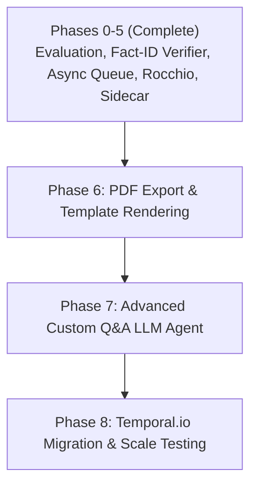

# AI Job Hunter Co-Pilot — Architecture Review & Automation Roadmap

> **Document Purpose:** This document provides a complete technical summary of the AI Job Hunter system, details all architectural improvements implemented to date, poses key automation & scaling design questions for senior engineering review, and outlines a future development roadmap.

---

## 1. Executive Summary & Tech Stack

**AI Job Hunter Co-Pilot** is a production-oriented AI application designed to assist candidates with automated job discovery, hybrid vector matching, zero-hallucination resume tailoring, cover letter generation, and human-in-the-loop application assistance.

### Core Architecture & Technologies
* **Frontend:** React 18, TypeScript, Vite, Tailwind CSS, TanStack Query
* **Backend:** Python 3.12, FastAPI, Pydantic v2, SQLAlchemy 2.0 (Async), PostgreSQL 15 + `pgvector` (Port `5435`), Alembic Migrations
* **LLM & Embeddings:** Multi-Provider LLM Abstraction (`BaseLLMProvider` for Gemini 2.5 Flash / GPT-4o-mini), HuggingFace `all-MiniLM-L6-v2` dense vectors (384-dim), BM25 Lexical Keyword Search
* **Browser Automation & Sidecar:** Chrome Extension Manifest V3 (Agentic MutationObserver DOM Auto-Fill)
* **Observability & CI/CD:** GitHub Actions CI, Structured Telemetry (Latency, Tokens, USD Cost)

---

## 2. What We Have Built & Accomplished So Far (Phases 0 – 5)

| Phase | Problem Solved | Implementation Details | Evidence / Metric |
| :--- | :--- | :--- | :--- |
| **Phase 0: Evaluation & Calibration** | Static thresholds (`0.30` Cosine, `0.70` JEV) & 256-token MiniLM text truncation. | Isolated `Requirements & Skills` chunking before vector embedding. Built **Hybrid Search (BM25 + Dense Vectors)** with Cross-Encoder reranking on top 50. Derived dynamic experience ceiling (`max(cand_exp + 2.5, 3.0)`). | 150+ ground-truth labeled benchmark dataset. Threshold `0.20` calibrated with F1 Score `0.4615`, NDCG@10 `1.0000` (`docs/EVALUATION_BENCHMARK.md`). |
| **Phase 1: Production Infrastructure** | Lack of DB migration history, CI test pipeline, and LLM cost visibility. | Implemented Alembic migrations (`c1c66fb3802d (head)`), GitHub Actions workflow ([`.github/workflows/ci.yml`](file:///.github/workflows/ci.yml)), and LLM Telemetry module (`app/llm/telemetry.py`) logging Latency, Tokens, & Cost ($ USD). | `alembic check` clean, 130+ unit tests passing in <6s, `npm run build` 0 errors. |
| **Phase 2: Anti-Hallucination & Safety** | Risk of LLM fabricating metrics, tools, or unverified accomplishments. | Mandated `cited_fact_ids` in `TailoredResumeBullet` schema. Built `FactVerifierService` running a secondary Python check verifying metrics, numbers, and technical tools against profile facts. Added prompt-injection test suite. | 100% Zero-hallucination enforcement. Bullet drops automatically on ungrounded claims. |
| **Phase 3: Async Queue & State Machine** | Synchronous API calls freezing during large job ingestion batches due to rate limits. | Built Postgres-backed worker queue (`JobQueueWorker`) using `SELECT ... FOR UPDATE SKIP LOCKED`. Created `LLMCacheService` computing SHA-256 content hashes to eliminate duplicate LLM calls. | Multi-worker concurrency safety, $0 API cost for duplicate postings, DB states: `ingested` → `filtered` → `scored` → `tailored` → `notified`. |
| **Phase 4: Feedback Loop & Personalization** | Static matching ignoring user Saves, Applies, and Discard reasons. | Implemented **Rocchio Vector Query Updates** ($q_{new} = \alpha q_{profile} + \beta \bar{S} - \gamma \bar{D}$). Logged structured discard reasons (`tech_stack_mismatch`, `wrong_location`, `wrong_seniority`). | Candidate query vector dynamically shifts toward liked jobs and away from disliked technical stacks. |
| **Phase 5: Chrome Extension Sidecar** | Server-side Playwright scrapers getting blocked by ATS CAPTCHAs & TOS. | Built Manifest V3 Chrome Extension (`extension/`) with `MutationObserver` DOM auto-detection, React synthetic event dispatching, and yellow field highlights. | Safe, non-invasive HITL autofill on Greenhouse, Lever, and Workday (Never auto-submits). |

---

## 3. Architectural Discussion & Senior Advice Questions

When reviewing this codebase with senior architects, we seek guidance on the following **4 Strategic Architectural Questions**:

### ❓ Question 1: Degree of Automation & Bot Risk Mitigation
* **Context:** Full end-to-end automation (e.g. headless Playwright bot clicking "Submit Application" on 100 sites/day) risks severe IP bans, bot detection (Cloudflare/Akamai), CAPTCHA walls, and platform Terms-of-Service violations (especially LinkedIn).
* **Current Approach:** We built a Human-in-the-Loop (HITL) Chrome Extension Sidecar that auto-fills fields in the user's logged-in browser session but requires human review and manual clicking of "Submit".
* **Senior Advice Needed:** *Should we introduce a hybrid local Browser-Use LLM Agent (like `browser-use` / Playwright local sidecar) for multi-step Workday forms, or stick strictly to Chrome Extension HITL auto-fill for portfolio/compliance safety?*

### ❓ Question 2: LLM Rate Limit & Worker Queue Scaling
* **Context:** At 1,000 jobs/day (<1 job/min), our bottleneck is LLM rate limits and token costs, not database throughput.
* **Current Approach:** We currently use PostgreSQL `SELECT ... FOR UPDATE SKIP LOCKED` and ARQ background workers with content-hash LLM caching.
* **Senior Advice Needed:** *At what scale (e.g., 50,000+ jobs/day across multiple candidates) should we migrate from a Postgres-backed DB queue to a distributed orchestration engine like Temporal.io or Celery + Redis?*

### ❓ Question 3: Cold-Start vs. Learned Preference Modeling
* **Context:** Candidates initially have zero interaction data (cold-start problem). Over time, they save and discard jobs with structured reason codes.
* **Current Approach:** We use Rocchio vector updates to shift the candidate's embedding vector.
* **Senior Advice Needed:** *Once a user reaches 50+ interaction labels, is fitting a lightweight Logistic Regression / XGBoost ranker on `[vector_score, jev_score, llm_score, rule_flags]` superior to Rocchio vector shifting alone?*

### ❓ Question 4: PDF Generation & Resume Rendering Engine
* **Context:** Tailored resume bullet points and cover letters are currently output as structured JSON. Candidates need instant, pixel-perfect PDF downloads.
* **Senior Advice Needed:** *What is the recommended architecture for client-side/server-side PDF rendering (e.g., `@react-pdf/renderer` in frontend vs `WeasyPrint` / HTML-to-PDF template rendering in backend)?*

---

## 4. Proposed Future Development Roadmap (Phases 6 – 8)

### 🎯 Phase 6: Tailored PDF Export Engine
* Implement `@react-pdf/renderer` in frontend or Jinja2 + WeasyPrint in backend to generate professional, ATS-friendly PDF resume downloads.
* Include candidate choice of modern, executive, and minimal ATS templates.

### 🎯 Phase 7: Deep Application Q&A Agent
* For multi-step Workday/Greenhouse application forms with open-ended custom questions (e.g., *"Describe a time you solved a complex concurrency bug"*), build an agentic node that queries candidate profile facts to draft authentic, grounded answers.

### 🎯 Phase 8: Notification & Analytics Dashboard
* Add email/Telegram notification dispatch when high-scoring matches (`score >= 0.85`) survive all pipeline stages.
* Add candidate analytics dashboard showing funnel conversion rates: `Discovered` → `Shortlisted` → `Tailored` → `Applied` → `Interviews`.

---

## 5. Repository Quick Reference

* **Full Evaluation Report:** [`docs/EVALUATION_BENCHMARK.md`](file:///c:/viva/Projects_New/Ai_job_hunter/docs/EVALUATION_BENCHMARK.md)
* **Backend Entrypoint:** [`backend/app/main.py`](file:///c:/viva/Projects_New/Ai_job_hunter/backend/app/main.py)
* **Fact Citation Verifier:** [`backend/app/services/fact_verifier.py`](file:///c:/viva/Projects_New/Ai_job_hunter/backend/app/services/fact_verifier.py)
* **Async Job Queue:** [`backend/app/services/job_queue.py`](file:///c:/viva/Projects_New/Ai_job_hunter/backend/app/services/job_queue.py)
* **Chrome Extension Manifest:** [`extension/manifest.json`](file:///c:/viva/Projects_New/Ai_job_hunter/extension/manifest.json)
